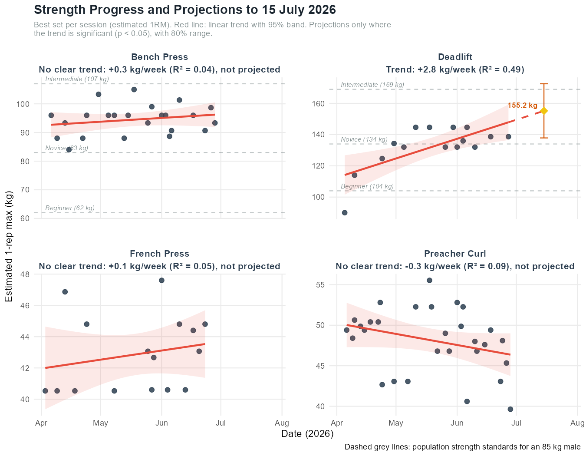

# Strength Analysis Dashboard (R)

Over about three months of training (April to June 2026), only my deadlift improved at a rate the data can support: about 2.8 kg a week, projecting to roughly 155 kg by 15 July 2026. Bench press, French press and preacher curl show no clear trend, so the dashboard makes no projection for them.



## Data

`lifts.csv` is my own training log: 887 sets across 3 April to 28 June 2026. Each row is one set, with the exercise, weight, reps, RPE and an estimated one-rep max (`Est_1RM`) for working sets.

## Method

1. **One value per session.** Later sets in a session are weaker because of fatigue, and sets from the same session are not independent measurements. So each session contributes a single value: its best estimated 1RM. Using every set instead made the trend noisier and dragged it down.
2. **A linear trend for each lift.** I fit an ordinary least squares line of best-set 1RM against date. The slope is the rate of progress in kg per week.
3. **Only project a trend the data supports.** A trend counts as real only if it is upward and statistically significant (p < 0.05). For those lifts the dashboard extends the line to 15 July and shows an 80% prediction range. The other lifts are labelled "no clear trend" and are not projected.
4. **Benchmarks.** Dashed lines show population strength standards for an 85 kg man (beginner, novice, intermediate) on the two compound lifts.

## Results

| Lift | Sessions | Trend (kg/week) | p-value | R² | Projection for 15 July |
|---|---|---|---|---|---|
| Deadlift | 15 | +2.8 | 0.004 | 0.49 | 155.2 kg (80% range 138 to 173 kg) |
| Bench press | 23 | +0.3 | 0.33 | 0.04 | None: no clear trend |
| French press | 16 | +0.1 | 0.43 | 0.05 | None: no clear trend |
| Preacher curl | 29 | −0.3 | 0.11 | 0.09 | None: no clear trend |

Full figures are in `trend_summary.csv`.

## Limitations

- **Short period.** Three months of data. A significant trend over that window says little about the long term.
- **Straight lines are optimistic.** Strength gains slow down over time, so a linear projection overstates progress the further out it goes.
- **Estimated, not tested, maxes.** `Est_1RM` is calculated from submaximal sets, not from true one-rep max attempts.

## An earlier version

An earlier version of this chart adjusted the data for bench press, French press and preacher curl so that they showed steady upward progress. That was a mistake: the real data shows those lifts were flat or declining. This version uses the data unchanged and only projects where the evidence supports it.

## Running it

Open `strength_dashboard.R` in RStudio and run it from the folder containing `lifts.csv`. It needs the `tidyverse` package. It saves `strength_dashboard.png` and `trend_summary.csv`.

```r
setwd("path/to/this/folder"); source("strength_dashboard.R")
```

Developed with AI-assisted coding; the data, analysis decisions and interpretation are my own.

---
Sam Diggens · Economics graduate, University of Kent
